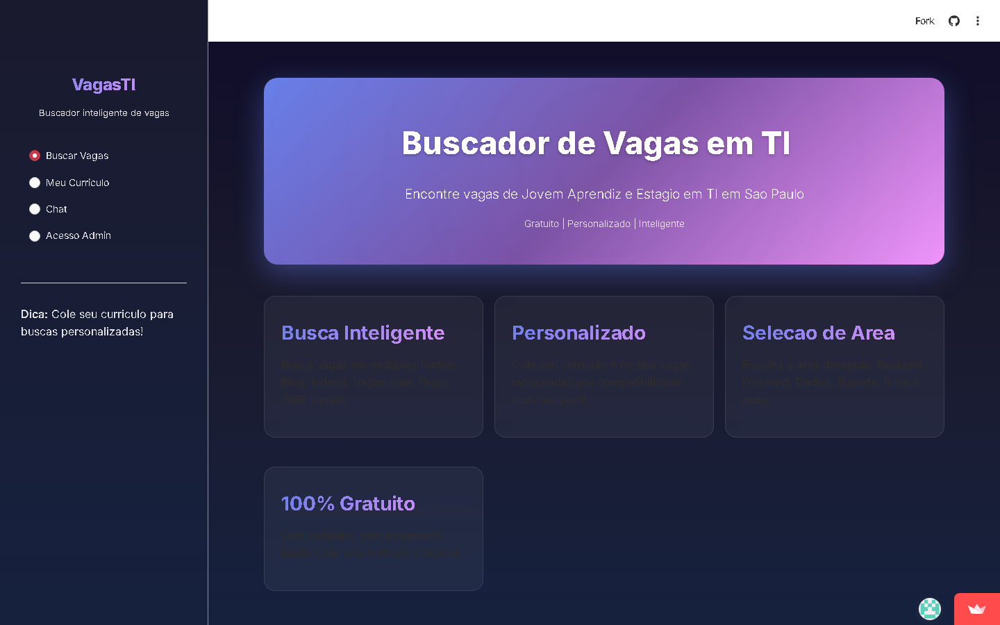
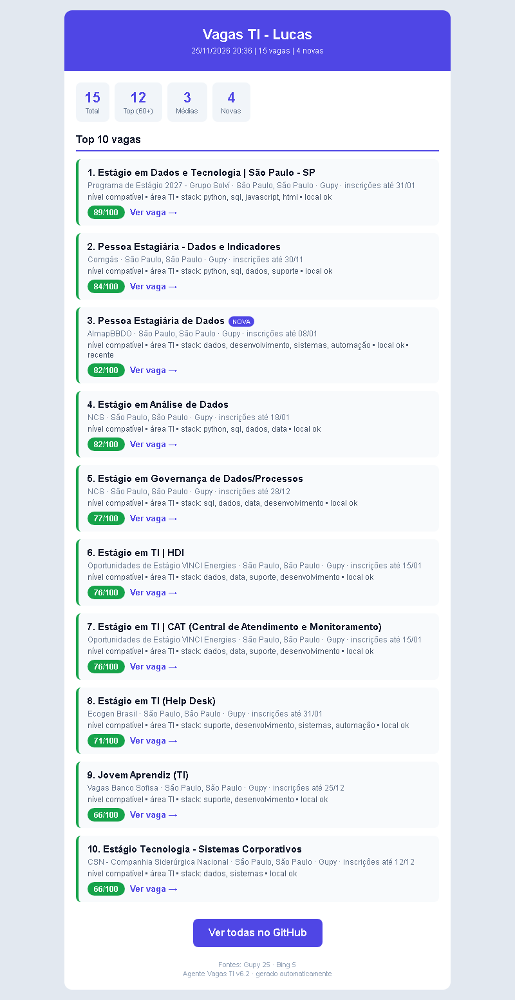
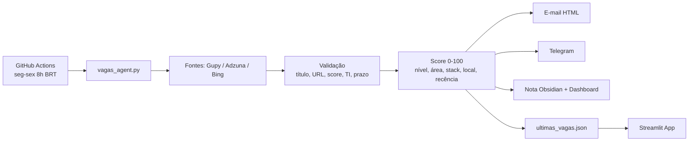

# 🤖 Agente de Vagas TI — Lucas Barbosa Pedro

   

Agente automatizado que busca vagas de **Jovem Aprendiz** e **Estágio em TI** compatíveis com o currículo de Lucas, ranqueia por compatibilidade e gera relatório no Obsidian + e-mail.

**Demo:** [App no Streamlit](https://agente-vagas-ti-cylvmizosdkjxcsp8pskwh.streamlit.app)




---

## Problema → Solução → Resultado

**Problema:** Buscar vagas de estágio/Jovem Aprendiz em TI manualmente consome horas por dia, e a maioria das vagas não combina com o perfil do candidato.

**Solução:** Um agente em Python que coleta vagas de múltiplas fontes (Gupy, Adzuna, Bing), valida e ranqueia cada uma por compatibilidade com o currículo (stack, nível, localização, recência), gerando um relatório em Markdown (Obsidian) e e-mail HTML.

**Resultado:** ~138 vagas encontradas por execução, ~71 aprovadas (score ≥ 30), com as 10 melhores enviadas por e-mail e dashboard no Obsidian — tudo automatizado via GitHub Actions (seg–sex, 8h BRT).

---

## Funcionalidades

- 🔍 **Múltiplas fontes:** Gupy API, Adzuna API, Bing (scraping com decodificação de redirect)
- 📊 **Score 0–100** por compatibilidade (nível, área TI, stack, localização, recência)
- 📧 **E-mail HTML diário** (Top 10 vagas, scores, links diretos, stats, fontes)
- 📱 **Bot Telegram** com comandos: `/buscar`, `/candidaturas`, `/stats`, `/entrevista`, `/curriculo`, `/status`, `/followup`, `/salario`
- 🌐 **Site Streamlit** (modo público: busca com currículo próprio, upload/análise, chat "bbzinho"; modo admin: candidaturas, prep de entrevista, currículo personalizado, analytics, Agente IA com Gemini)
- 🤖 **GitHub Actions** — execução agendada seg–sex às 8h (BRT), sem precisar do PC ligado
- 📋 **Gestão de candidaturas** (6 status, follow-up 7+ dias, stats de taxa de resposta/entrevista)
- 📝 **Relatório Markdown (Obsidian)** com frontmatter YAML e dashboard (Obsidian Base)
- 🎯 **Prep de entrevista** e **currículo personalizado** por vaga

---

## Arquitetura



---

## Como o score funciona

Cada vaga recebe pontuação de 0 a 100:

| Critério | Peso | Descrição |
|---|---|---|
| Nível compatível | +25 | estágio, aprendiz, trainee, júnior |
| Área TI | +20 | ti, tecnologia, software, sistemas, dados, etc. |
| Stack | +até 30 | python=8, sql=6, flask=4, mysql=4, git=3, node=3, javascript=3, html=2, css=1, dados/data=4, suporte=3, backend/back-end=4, desenvolvimento/desenvolvedor=3, sistemas=2, api=2, automação=3 |
| Localização | +15 | SP ou remoto |
| Recente | +10 | ≤ 7 dias |
| Penalidade (nível acima) | −50 | sênior, pleno, especialista, líder, coordenador, gerente, arquiteto, staff, tech lead |
| Penalidade (fora da região) | −20 | cidade fora da região (exceto remoto) |

Vagas com score < 30 ou não-TI são descartadas. Top: score ≥ 60. Médias: 40–59.

---

## Stack e tecnologias

- **Python 3.10+**
- **requests** — requisições HTTP (Gupy, Adzuna, Bing)
- **BeautifulSoup4** — parsing HTML
- **Streamlit** — app web (Streamlit Cloud)
- **smtplib** — envio de e-mail (Gmail SMTP SSL)
- **Telegram Bot API** — notificações push
- **GitHub Actions** — automação (cron seg–sex 8h BRT)
- **Obsidian** — notas Markdown + Base (dashboard)

---

## Como rodar localmente

```powershell
# 1. Clonar o repositório
git clone https://github.com/lucass1108/agente-vagas-ti.git
cd agente-vagas-ti

# 2. Instalar dependências
pip install -r requirements.txt

# 3. Configurar (edite a seção CONFIG no vagas_agent.py ou use variáveis de ambiente)
#    EMAIL_PASSWORD, ADZUNA_APP_ID, ADZUNA_APP_KEY, etc.

# 4. Rodar
python vagas_agent.py --dry-run          # busca + preview.html
python vagas_agent.py --email            # busca + e-mail
python vagas_agent.py --telegram         # busca + Telegram
python vagas_agent.py --schedule         # modo agendado
python vagas_agent.py --listar           # listar candidaturas
python vagas_agent.py --stats            # estatísticas
python vagas_agent.py --entrevista "Vaga"  # prep de entrevista
python vagas_agent.py --curriculo "Vaga"   # currículo personalizado
python vagas_agent.py --dashboard        # dashboard Obsidian
python vagas_agent.py --analytics        # analytics
```

---

## Variáveis de ambiente / GitHub Secrets

| Variável | Descrição |
|---|---|
| `EMAIL_PASSWORD` | Senha de app do Gmail |
| `ADZUNA_APP_ID` | ID do Adzuna |
| `ADZUNA_APP_KEY` | Key do Adzuna |
| `TELEGRAM_BOT_TOKEN` | Token do bot Telegram |
| `TELEGRAM_CHAT_ID` | ID do chat Telegram |
| `VAULT_PATH` | Caminho do vault Obsidian (auto-detectado) |
| `ADMIN_KEY` | Chave de acesso admin (Streamlit) |
| `GEMINI_API_KEY` | Chave do Gemini (Streamlit) |

---

## Estrutura de pastas

```
agente-vagas-ti/
├── vagas_agent.py          # Script principal (v6.2)
├── streamlit_app.py        # App web (Streamlit Cloud)
├── telegram_bot.py         # Bot Telegram
├── requirements.txt        # Dependências
├── README.md               # Este arquivo
├── .github/
│   └── workflows/
│       └── vagas.yml       # GitHub Actions (automação)
├── docs/                   # Prints/GIFs para o README
└── .env.example            # Variáveis de ambiente (template)
```

---

## Roadmap

- [x] Testes básicos (pytest) para score e validação de vagas, rodando no GitHub Actions
- [x] Logging com arquivo (agente.log), retry 3x por fonte, tolerância a falhas
- [x] Score explicável (motivos no e-mail, Telegram e Streamlit)
- [x] Streamlit: vagas de exemplo, filtros, exportar CSV, aviso de privacidade
- [ ] Histórico em SQLite (deduplicação persistente)
- [ ] Modularizar vagas_agent.py (fontes/, score.py, notificacoes/, db.py)
- [ ] Filtros no site Streamlit (área, modalidade, data) e exportar resultados
- [ ] Explicar por que cada vaga recebeu aquele score
- [ ] Mostrar vagas de exemplo sem exigir currículo
- [ ] Segredos só em GitHub Secrets/variáveis de ambiente + `.env.example`

---

## Extras

- **Obsidian:** relatório Markdown com frontmatter YAML (`Vagas TI - Lucas.md`) e dashboard (Obsidian Base) gerado via `--dashboard`.
- **Toast Windows:** não identificado no código atual (menção apenas em documentação antiga).

---

## Autor

**Lucas Barbosa Pedro**
- GitHub: [@lucass1108](https://github.com/lucass1108)
- LinkedIn: [lucasbarbosapedro](https://linkedin.com/in/lucasbarbosapedro)
- Email: lucasbarbosapedro1108@gmail.com

---

> Projeto desenvolvido como parte dos estudos em Análise e Desenvolvimento de Sistemas (ADS) — UNIFECAF.

---

### O que não consegui confirmar no código

- `telegram_bot.py` e `.github/workflows/vagas.yml` não estão no vault local; as informações sobre comandos do bot e o workflow foram retiradas do `README.md` existente e da nota de projeto.
- O conteúdo exato do `streamlit_app.py` foi lido (completo); as funcionalidades do modo público/admin foram confirmadas.
- `requirements.txt` contém `requests`, `beautifulsoup4`, `streamlit`, `pandas` — suficiente para o código importado (resto é stdlib).
- Não existem testes no repositório; `.env.example` foi criado.

---

## Licença

MIT License — veja [LICENSE](LICENSE) para detalhes.